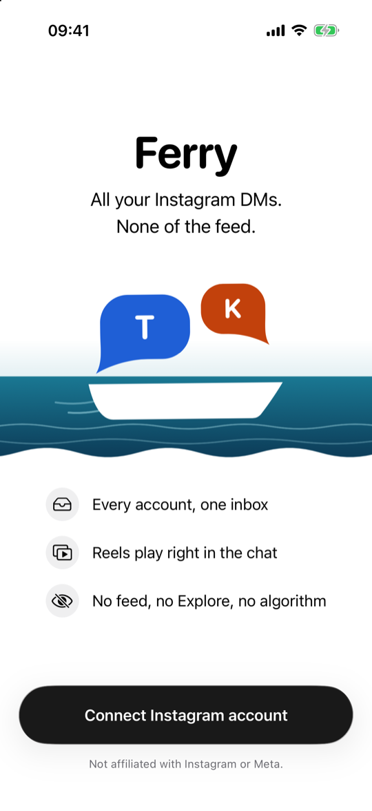
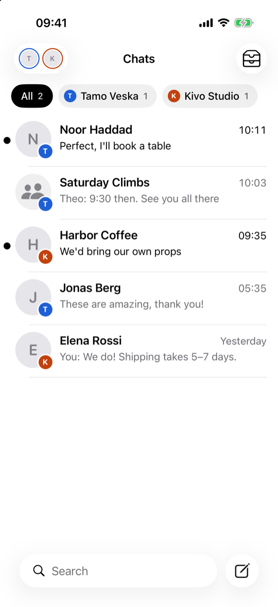
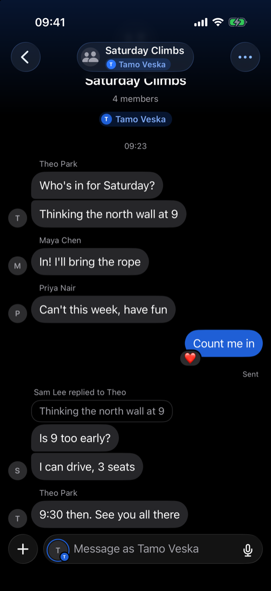
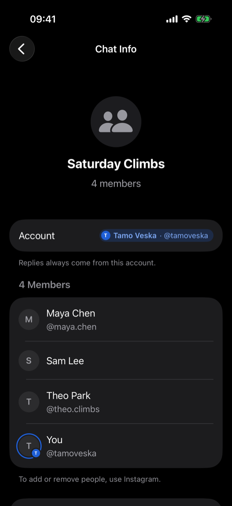

# Ferry Messenger

Ferry Messenger is an iPhone app for your Instagram direct messages and nothing else. All your Instagram accounts in
one inbox, and no feed, no Explore, no algorithm.

  
  
  
  

Made-up accounts and chats, on the iPhone simulator.

## What it does

- **All your accounts in one inbox.** Give each account a name, a colour and a letter, so you always know which
  account a chat belongs to. Tap an account to see only its chats.
- **Replies always come from the right account.** Every chat stays with the account it belongs to.
- **Everything you'd expect in a chat:** replies, reactions, edits, unsending, typing and "Seen".
- **Photos, videos, voice notes and GIFs,** sent and received. Shared reels play right in the chat.
- **Message requests,** opened without sending "Seen". Accept or delete them when you're ready.
- **Primary and General** for business and creator accounts, plus an archive for chats you're done with.
- **Notifications** for new messages while the app is closed. They're not instant: they come when iOS lets the app
  check, sometimes hours later.
- Light and dark mode, large text and VoiceOver.

## How it works

Ferry Messenger talks to Instagram directly from your iPhone, the same way Instagram's website does. There's no
server and no account to create: nothing sits between you and Instagram.

Notifications work the way they do for Instagram's website in Firefox: Instagram sends them to Mozilla's push
service, which keeps them until your iPhone collects them. They're encrypted so that only your iPhone can read them.

## Privacy

- You log in on Instagram's own login page, inside the app. The app never sees or stores your password.
- Your Instagram session stays in your iPhone's Keychain.
- The app talks to Instagram and, if you turn on notifications, to Mozilla's push service. Mozilla can't read your
  notifications; it only sees that one arrived and when. The one other exception: when you send a message that is just
  a link to a GIF, the app downloads that GIF to send it as a GIF.
- No analytics and no tracking.

## Good to know

- **Notifications are late, by design.** iOS decides when the app may check, sometimes hours after a message
  arrives, and not at all after you swipe the app away, until you open it again. Reactions, and photos and videos
  taken with Instagram's camera, don't notify.
- **Instagram's end-to-end encrypted chats** can't be shown; open those in Instagram.
- **It's unofficial.** Instagram can change how its website works, and it may ask you to confirm a new login in the
  Instagram app. Do your first logins on your home Wi-Fi.
- **A very small risk to your account.** Instagram doesn't approve of unofficial apps, and it can restrict or ban
  accounts it thinks are automated. Ferry Messenger uses Instagram the way its website does, from your own phone and
  only while the app is open, so the risk is very small, but it isn't zero.

Ferry Messenger is not affiliated with Instagram or Meta.

## Install

Ferry Messenger isn't on the App Store, so you install it yourself:

- **With AltStore or SideStore:** download `FerryMessenger.ipa` from the
  [latest release](https://github.com/luisten/ferry-messenger/releases/latest) and open it in AltStore or SideStore.
  They install it with your free Apple account and renew it every week.
- **From the source code, with a Mac and Xcode:** follow
  [Install on your iPhone](docs/DEVELOPMENT.md#install-on-your-iphone).

With a free Apple account, an app you install yourself stops opening after 7 days until it's renewed (AltStore and
SideStore do that for you). With a paid Apple Developer account it lasts a year.

## For developers

How it's built, how to run the tests, and how releases are signed: [docs/DEVELOPMENT.md](docs/DEVELOPMENT.md).

## Licence

Ferry Messenger is under the [GNU AGPL-3.0](LICENSE), because it uses
[mautrix](https://github.com/mautrix/meta)'s Instagram library, which is AGPL-3.0. If you give the app to other people,
the AGPL asks you to offer them its source code too.
