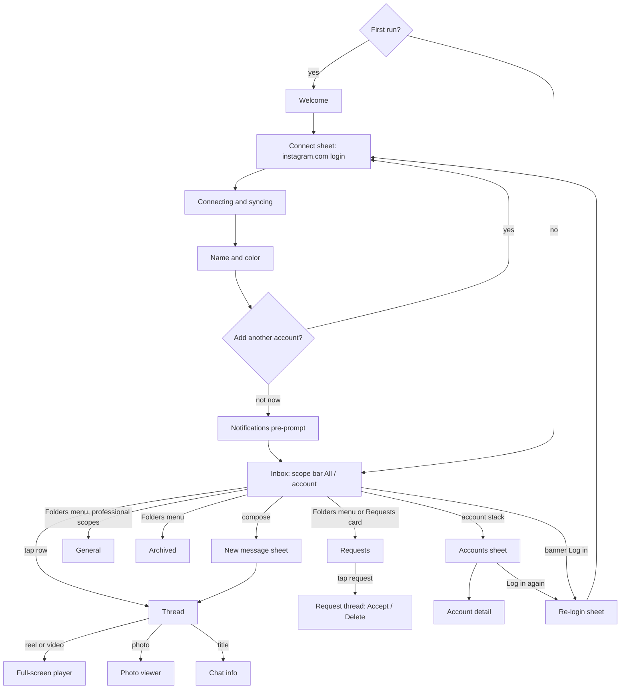

# Ferry: design spec

Version 1, 2026-10-12; inbox v2 2026-10-14 (D14, [review](REVIEW-2026-10-14.md), [`mockups-v2.html`](mockups-v2.html));
v3 2026-10-15: renamed **Ferry** (D15, formerly "IG Messenger"), app icon and launch screen (§18), account stack without
overlap, design pass ([review](REVIEW-2026-10-15.md), [`mockups-v3.html`](mockups-v3.html)); round 2 the same day: the
icon in colour (the user's decision), the launch screen to match, and a new Welcome (review "Round 2").
Target: iPhone, portrait, **iOS 26+** (Liquid Glass), SwiftUI.
Companion file: [`mockups.html`](mockups.html). Open it in a browser; the toggle at the top switches light and dark.

Inputs: [`../BRIEF.md`](../BRIEF.md), [`../research/beeper-ux.md`](../research/beeper-ux.md),
notes on an earlier web-wrapper prototype, [`../research/matrix-bridge.md`](../research/matrix-bridge.md)
(mautrix-instagram v26.09).

Tags used throughout:

| Tag | Meaning |
|---|---|
| **[v1]** | Ship in the first build. |
| **[later]** | Designed now, built when the bridge supports it or when v1 is stable. The layout already has a slot for it. |
| **[bridge]** | Behaviour depends on what mautrix-instagram sends. The section names the field or endpoint. |
| **[$$]** | Expensive for one engineer. A cheaper fallback is given in §14. |

---

## 0. The decisions that matter most

1. **Color means account.** The app chrome is monochrome (black and white with system grays). The only chromatic
   color in the UI belongs to one of your Instagram accounts: its badge, its tag, and **your sent bubbles**.
   Media content and status glyphs are the exceptions, and status always carries a glyph as well as a color. The
   brand's sea (§0.8) is scenery, not UI: it appears only in the app icon, the launch screen and the Welcome picture.
2. **Every account has a mark.** Name + color + a one-character mark (`S`, `P`, an emoji). Color is never shown
   without the mark or the name, so the system works for color-blind users and VoiceOver.
3. **Threads are locked to their account.** The bridge creates one Matrix room per IG account per conversation
   (`m.bridge` → `channel["fi.mau.receiver"]`). The thread header, the bubble color and the composer placeholder
   ("Message as Studio") all say which account you are using. There is no account switcher in a thread, so a
   wrong-account reply cannot happen.
4. **One control picks whose chats you see. Folders are places, not filters.** A single scope bar
   (`All · Personal · Studio · Band`) sits under the title. Folders live in the **Folders menu** (top right) and push
   a screen scoped to the current selection. A folder shows itself in the list only when it has something new:
   today, that's new requests (the Requests card). *(v2, D14; v1 had tiles at the top of the list.)*
5. **Reels are video messages.** Thumbnail first, tap to play inline, expand to a vertical full-screen player
   that shows one reel and nothing else. Swiping either way returns you to the chat. Author and caption come
   from the bridge's caption body.
6. **Account health is one glance and one tap away.** The account stack in the top-left of the inbox puts a warning
   badge on the avatar of the account that needs you. Banners name the account and the fix. *(v3: was one glyph after
   the stack.)*
7. **Native first.** About 80% of the app is stock SwiftUI. Custom work is limited to about ten views (§13).
8. **Ferry carries your messages across.** The icon is a white ferry carrying two bubbles side by side over deep water
   (§18). The sea is the brand's one colour, and it is only ever scenery: the icon, the launch screen and the Welcome
   picture. Everything you read or tap stays monochrome, so color in the UI still means "account". *(v3, D15; round 2:
   the user chose a coloured icon, replacing "the icon is monochrome".)*

---

## 1. Principles

1. **Native first, custom where it earns it.** Use NavigationStack, List, toolbars, `.searchable`, swipe actions,
   context menus, sheets, ShareLink, AVKit and Liquid Glass as they come. Spend custom design on message bubbles,
   media cards, the account identity system, connection state and onboarding.
2. **The account is always legible.** In every place where you could act as an account, you can see which one,
   including over media: identity in a toolbar sits on glass. *(v3: the thread header lost its tag over photos.)*
3. **Show identity only when it tells accounts apart.** In the "All" scope every row carries a mark. In a single
   account scope the marks disappear, because the whole screen already wears that account's color and name.
4. **Messages, not media feeds.** No autoplay, no "next reel", no Explore. A shared reel opens alone and closes back
   to the conversation. This carries over the PoC's anti-doomscroll value.
5. **Learn account facts from data, not from UI shape.** The PoC showed that Instagram varies its UI per account.
   Folders and account type appear only when the bridge reports them.
6. **Every failure names the account, the cause and the fix.** "Studio is signed out. Log in again." Never a bare
   "Error".
7. **Destructive actions say what they touch.** Removing an account deletes its chats from this app, not from
   Instagram, and the confirmation says so.
8. **One engineer can build it.** When a polished version is expensive, the spec gives a cheaper version that still
   looks right (§14).
9. **Your accounts sit side by side, never over each other.** No avatar of yours overlaps another of yours: the toolbar
   stack, onboarding, banners. The icon shows the same idea. *(v3: the stack used to overlap like a pile of faces.)*
10. **The sea is Ferry's, and only scenery.** The app icon, the launch screen and the Welcome picture may use the brand's
    sea (§8.1 "Brand"). Text, controls, tint and chrome never do, so color in the UI still means account. *(Round 2,
    2026-10-15: **the user's decision** to have a coloured icon replaces v3's "The brand is monochrome too".)*

---

## 2. Information architecture

### 2.1 Navigation map

### 2.2 Containers

| Container | Contents | SwiftUI |
|---|---|---|
| Root | One `NavigationStack` with Inbox as root. **No tab bar**: the app has one job. | `NavigationStack(path:)` |
| Push | Thread, Requests, General, Archived, Chat info | `navigationDestination` |
| Sheet | Accounts (own stack), New message, Re-login, Connect | `.sheet`, detents `[.medium, .large]` where noted |
| Full screen | Onboarding (first run), reel/video player, photo viewer | `.fullScreenCover` + zoom transition |
| In place | Search (bottom field, iOS 26 placement) | `.searchable` |

### 2.3 Screen index

| ID | Screen | Status |
|---|---|---|
| O1 | Welcome | v1 |
| O2 | Server sign-in (only if the app is not preconfigured for one homeserver) | v1, conditional |
| O3 | Connect: instagram.com login sheet | v1 |
| O4 | Connecting and syncing | v1 |
| O5 | Name and color | v1 |
| O6 | Add another account? | v1 |
| O7 | Notifications pre-prompt | v1 |
| I1 | Inbox (scope All or one account) | v1 |
| I2 | Requests | v1 |
| I3 | General | later [bridge] |
| I4 | Archived | v1 |
| I5 | Search | v1 |
| N1 | New message | v1 |
| T1 | Thread | v1 |
| T2 | Request thread | v1 |
| T3 | Chat info | v1 (minimal) |
| M1 | Reel / video player | v1 |
| M2 | Photo viewer | v1 |
| A1 | Accounts | v1 |
| A2 | Account detail | v1 |
| A3 | Re-login sheet | v1 |

---

## 3. The account identity system

This is the core design problem. Beeper has no documented way to tell two accounts on the same network apart
(beeper-ux §1.3). We do it with four redundant signals: **color, mark, name, placement**.

### 3.1 Anatomy of an account identity

| Part | Source | Rules |
|---|---|---|
| **Name** | User-chosen at O5. Suggestions: "Personal", "Work", "Studio", "Shop", "Creator", or the IG display name. | 1–16 characters. Unique across accounts. |
| **Color** | User-chosen from 8 options (§3.4). Auto-assigned in order: Ocean, Ember, Grape, Teal, Berry, Moss, Cocoa, Slate. | Unique. Colors already used show the other account's mark and cannot be picked. |
| **Mark** | One grapheme: a letter (default: first letter of the name) or one emoji. | Unique. If the first letter is taken, suggest the next distinct letter of the name. |
| **Avatar** | IG profile photo from `/v3/whoami` `profile.avatar`. Cache the bytes (CDN URLs expire, per the PoC). | Shown only for *your* accounts, always with a 2 pt ring in the account color. |
| **Handle** | `profile.username` from `/whoami`. | Shown as `@marlo.studio` next to the name in thread headers, Accounts and the re-login sheet. |

Identity is stored on our side, keyed by the bridge login ID (the account's FBID). Sync it through Matrix account
data (a custom `com.igmessenger.accounts` event) so it survives reinstalls. **[v1]** *(v3: not built yet; choose the
final namespace before building it. Existing `com.igmessenger.*` keys, such as the archive tag's `archived_at`, are data
on the server: keep reading them after the rename.)*

### 3.2 Components

| Component | Looks like | Used in |
|---|---|---|
| **AccountMark** | Filled circle in the account color, white mark in SF Pro Rounded Bold, 2 pt ring in the surface color so it reads as a cut-out when it overlaps an avatar. | Inbox rows (All scope), folder rows, search results, scope chips, notifications fallback |
| **AccountTag** | Capsule: mark + name, wash background, ink text. Optional handle after a middle dot. | Thread header, player footer, request rows, banners, New message "From" |
| **AccountAvatar** | Your IG avatar, 2 pt gap, 2 pt ring in account color, mark at bottom-right. | Composer, Accounts, onboarding, re-login sheet |
| **AccountStack** | Up to three 30 pt AccountAvatars **side by side, 4 pt apart**, in one 44 pt glass capsule; from four accounts on, the first two and a "+N" disc. Status is a 14 pt badge on that account's avatar (§3.5). *(v3: was overlapping by 40%, with a glyph after the stack.)* | Inbox toolbar, leading. Opens Accounts. |

### 3.3 Where identity appears

| Surface | Signal | Notes |
|---|---|---|
| Inbox, All scope | AccountMark on the contact avatar (bottom-right) | The fastest signal. Same person messaging two of your accounts = two rows with two different marks. |
| Inbox, account scope | Title = account name, subtitle = `@handle`, tint and a faint top wash in account color | Marks hidden (redundant). |
| Scope bar | Chip = mark + name + unread count | Selected account chip fills with the account color. |
| Thread header | AccountTag under the contact name (`S Studio · @marlo.studio`) | Always visible while scrolling (it lives in the toolbar). |
| Thread background | 10% account-color wash behind the top toolbar, fading to clear over 140 pt | Ambient cue. Removed with Reduce Transparency. |
| Your bubbles | Filled with the account color, white text | The strongest signal while typing and reading. |
| Composer | AccountAvatar inside the field + placeholder "Message as Studio" + send button in account color | Tap the avatar for an explanation popover. No switcher. |
| Player | AccountTag in the footer: "Shared by Maya · S Studio" | You know which account a reply will come from. |
| New message | Required "From" picker of AccountTags before the recipient field | Search runs against that account (`/v3/search_users?login_id=`), so the choice comes first. |
| Notifications | Title = contact, subtitle = "to Studio" | iOS cannot badge a sender avatar with our mark; the subtitle carries the account. |
| Accounts | AccountAvatar + name + handle + status | Edit name, color and mark in Account detail. |

### 3.4 Account palette

All fills pass **4.5:1 with white text** (WCAG AA for body text), so outgoing bubbles are readable in both modes.
Fills are the same in light and dark. "Ink" is the color for account-colored *text*; it changes in dark mode to stay
above 4.5:1 on black and on `#1C1C1E`. "Wash" is the fill at 12% (light) or 22% (dark) opacity.

| Name | SwiftUI (asset) | Fill (both modes) | Contrast, white text | Ink light | Ink dark | Ink dark on #000 / #1C1C1E |
|---|---|---|---|---|---|---|
| Ocean | `AccountColor.ocean` | `#1F5FD6` | 5.73 | `#1F5FD6` | `#7FAAF7` | 9.00 / 7.29 |
| Ember | `AccountColor.ember` | `#C2410C` | 5.18 | `#C2410C` | `#F59A6B` | 9.72 / 7.87 |
| Grape | `AccountColor.grape` | `#7A3FD1` | 6.07 | `#7A3FD1` | `#B897F5` | 8.78 / 7.12 |
| Teal | `AccountColor.teal` | `#0F766E` | 5.47 | `#0F766E` | `#5FCFC3` | 11.20 / 9.07 |
| Berry | `AccountColor.berry` | `#C2255C` | 5.66 | `#C2255C` | `#F27DA6` | 8.26 / 6.69 |
| Moss | `AccountColor.moss` | `#4D7C0F` | 4.99 | `#4D7C0F` | `#A3CF5F` | 11.65 / 9.44 |
| Cocoa | `AccountColor.cocoa` | `#8A5A2B` | 5.87 | `#8A5A2B` | `#D6A877` | 9.73 / 7.88 |
| Slate | `AccountColor.slate` | `#475B78` | 6.92 | `#475B78` | `#A9B8CF` | 10.44 / 8.46 |

Implementation: `enum AccountColor: String, CaseIterable, Codable` with computed `fill`, `ink`, `wash` from an asset
catalog folder `Account/<Name>/{Fill,Ink}` (Ink has a dark appearance). The palette avoids pure red, orange and
green, which are reserved for status.

Ember, Moss and Cocoa can look alike to people with red-green color blindness. That is why the mark is mandatory and
why the defaults put Ocean and Ember (blue/orange, the safest pair) first.

### 3.5 Geometry

| Context | Host size | Mark size | Mark font | Ring |
|---|---|---|---|---|
| Inbox row avatar | 52 | 20 | 11 pt rounded bold | 2 pt, row background |
| Folder/request row | 44 | 18 | 10 pt | 2 pt |
| Scope chip | n/a | 18 (leading) | 10 pt | none |
| AccountTag | n/a | 16 | 9 pt | none |
| Composer AccountAvatar | 28 | 12 | 7 pt | 1.5 pt |
| Toolbar AccountStack | 24 photo, 30 with gap and ring | none (status badge 14) | n/a | 1.5 pt + 1.5 pt gap |
| Accounts row | 44 | 18 | 10 pt | 2 pt |
| Onboarding preview | 88 | 30 | 16 pt | 3 pt |

Sizes scale with `@ScaledMetric(relativeTo: .caption2)` and are capped at 1.4× (a 28 pt mark on a row avatar at
accessibility sizes). Position: mark center at 84% of the host's width and height.

**AccountStack (v3):**
- **Avatars:** `AccountAvatar(size: 24, showsMark: false)` framed at 30 × 30 (the frame includes the ring), in
  `HStack(spacing: 4)`.
- **Capsule:** `.padding(.horizontal, 7)`, 44 pt tall, with its own `.glassEffect(.regular.interactive(), in: .capsule)`;
  the `ToolbarItem` uses `.sharedBackgroundVisibility(.hidden)`.
- **Widths:** 44 (one account), 78 (two), 112 (three or more).
- **Four or more accounts:** the first two in Accounts order, then a 30 pt `tertiarySystemFill` disc "+N"
  (`.footnote.weight(.semibold)`, rounded).
- **Status:** a 14 pt disc in the background color at the avatar's bottom-right, inside its frame:
  `exclamationmark.triangle.fill` at 9 pt in `statusWarn`, or a 9 pt spinner while connecting. Needs-you wins. A
  hidden account's status goes on "+N".
- **VoiceOver:** "Accounts: Alex, Alex Studio, and 2 more. Alex Studio needs attention."

### 3.6 Rules

1. No two accounts share a color or a mark. The picker enforces it.
2. Color is never alone. Every colored element shows the mark or the name.
3. Never color anything that is not your account: no colored group-member names, no colored unread dots, no
   colored chrome. Group sender names use secondary gray.
4. A thread's account comes from the bridge and never changes. The composer API takes a thread, not an account.
5. Same person on two accounts stays as two threads. **We do not merge chats** (Beeper does; it is what forces its
   composer switcher).
6. With one account connected, hide the scope bar and the row marks. Keep the composer placeholder
   ("Message as Personal"), so the model is already learned when a second account arrives.
7. Never overlap two of your own accounts' avatars (principle 9). Side by side with a gap, or a count. *(v3.)*

### 3.7 VoiceOver

- AccountMark and AccountAvatar are not separate elements. Their meaning merges into the parent's label.
- Inbox row: "Maya Chen, Studio account, unread, sent a reel, 9:41 AM." Custom actions: Archive, Mark as Read, Mute.
- Scope chip: "Studio, 3 unread, button, selected."
- Composer field label: "Message, sending as Studio, at marlo.studio."
- Composer avatar: "Sending as Studio. Double-tap for details."

---

## 4. Inbox model: scope and folders

### 4.1 The scope bar (the one control)

- A horizontal row of glass capsules pinned under the navigation title: **All**, then one chip per account in the
  user's order (drag to reorder in Accounts).
- Single selection. Changing scope cross-fades the list (0.2 s), retints the screen, and sets the inline title
  ("Chats" for All, the account name otherwise, with `navigationSubtitle("@handle")`). *(v2, D14: inline, not large.)*
- Chip content: AccountMark, name, unread chat count (or a status glyph when the account is not connected:
  spinner while connecting or syncing, orange triangle when it needs you).
- Hidden when only one account is connected.
- Scope is remembered across launches (`@SceneStorage`).
- Selection haptic: `.selection`.

### 4.2 Folders are places in a menu, not tabs

*(v2, D14. v1 drew a row of tiles under the scope bar; on a typical day it read "0 · 0 · (blank)" and cost 92 pt.)*

A **Folders** button sits in the inbox toolbar's top-right slot (glass, `tray.2`). Its menu lists the folders; each
item pushes a list scoped to the current selection.

| Item | Shown | Subtitle (never "0") |
|---|---|---|
| **General** | in a scope that holds a professional account, or any General chat **[bridge]** | "1 unread" |
| **Requests** | always | "2 waiting" (every request in scope) |
| **Archived** | always | none |

- **Badge** on the button: new requests in scope plus unread General chats in scope, in label color (monochrome
  chrome), hidden at 0.
- **Requests card:** the first list row, only while the scope has requests newer than the last time Requests was
  opened in a scope that shows them (All, or their account). A filled card (`tertiarySystemFill`, radius 16, about
  56 pt): "2 message requests", the requesters' names (each with its account's mark in All), a chevron. **No message
  text**, so spam never reaches the main list. It opens the Requests list, never a request thread. The "last opened"
  marker is a local time per scope (`UserDefaults`); nothing is sent.
- **General stays quiet:** no card. Its unread chats feed the badge and the menu only (Instagram doesn't notify for
  General by default); in a professional scope the subtitle "· Primary" says the list isn't everything.

Why this shape:
- **One control.** Folders do not nest under accounts or vice versa. Scope × folder is expressed as
  "where you are" (scope) + "where you go" (Folders menu).
- **Requests stay out of sight,** but the count is visible whenever it isn't zero (badge, menu, and a card for new
  requests). Zero is no longer drawn.
- **Zero state:** nothing at all between the chips and the first chat; the empty-state copy points to "Folders, top
  right" when chats are in General or Archived.

### 4.3 What appears where

| View | All scope | Account scope |
|---|---|---|
| Main list | Every account's chats (v1), or every account's Primary + personal chats (later), excluding requests and archived. Accounts with "Show in All Chats" off are excluded. | That account's chats (Primary, later). |
| Requests | All accounts' requests, in sections per account (section header = AccountTag + count). | That account's requests, no sections. |
| General (later) | All professional accounts' General chats, with marks. | That account's General chats. |
| Archived | All archived chats, with marks. | That account's archived chats. |

### 4.4 Account type, privacy and folders

The bridge does not expose personal/business/creator or private/public today (matrix-bridge §2). So:
- **v1 treats every account the same:** Chats + Requests. Account rows show no type label.
- **Later**, when the bridge reports type, show "Business", "Creator" or "Personal" and a lock glyph for private
  accounts in Accounts, and enable General for professional accounts.
- Private/public mostly shows up as **media availability**: a reel from a private account that the receiving account
  does not follow cannot be fetched. Section 6.3 covers that card.
- If the bridge ever reports `ig_inbox_folder` values for an account, show General for that account even if its
  type is unknown. Data wins over assumptions.

### 4.5 Counts, badges and notifications (defaults)

| Thing | Default |
|---|---|
| App icon badge | Unread chats in the All scope main list. Requests, archived and accounts with notifications off do not count. |
| Scope chip count | Unread chats in that account's main list. |
| Folders badge | New requests (since you last opened Requests in this scope) plus unread General chats. Hidden at 0. |
| Notifications per account | All (v1). "Primary only" is added later, with General. |
| Request notifications | Off (toggle per account). |
| Archived chats | Return to the list on new activity (message, reaction, mark unread). Archive is local to this app; Instagram is untouched. |

---

## 5. Screen specs

Each spec covers layout, components, states, interactions, haptics and accessibility notes. Measurements are in pt
at the default text size. Standard margins are 16 pt.

### O1. Welcome: "The crossing"

*(Round 2, 2026-10-15: a complete redesign at the user's request; it replaces v3's lockup. Directions B and C, the
reasoning and the full tables: [REVIEW-2026-10-15.md](REVIEW-2026-10-15.md) "Round 2", R2.3; drawn in
[`mockups-v3.html`](mockups-v3.html) "Round 2 · Welcome".)*

- **Idea:** the name, then the picture that explains it. The icon's ferry crosses a calm sea carrying your accounts as
  two bubbles in their own colours, side by side.
- **Layout** (393 × 852 pt, Large text), top-down in a `ScrollView` on `systemBackground`:
  - **Wordmark** "Ferry" at y 116: SF Pro Rounded Bold 48 pt (`@ScaledMetric(relativeTo: .largeTitle)`, capped at
    62 pt), tracking −0.5, centred.
  - **Headline**, 8 below: `.title3`, two centred lines, at most 320 wide.
  - **Scene**, 16 below, full width × 224:
    - the sky is the background;
    - a 40 pt haze above the horizon (y 132);
    - a sea band from the horizon to a wave edge at y 214 (amplitude 5, wavelength 131);
    - two swell lines;
    - a short wake;
    - the icon's hull × 0.3 in white, its deck 6 pt below the horizon;
    - the icon's bubbles × 0.3 in `AccountColor.ocean` ("A") and `.ember` ("S"), with white SF Pro Rounded Bold marks
      (36 and 29 pt).

    It uses fixed sample identities. At accessibility sizes it shrinks to 70%.
  - **Promises**, 28 below: three rows of a 36 pt `tertiarySystemFill` disc with the symbol (`tray`,
    `play.rectangle.on.rectangle`, `eye.slash`) and `.body` text, 16 apart, in a centred 300-wide column.
  - `Spacer(minLength: 24)`.
  - **Bar** (`safeAreaBar(edge: .bottom)`): the button, then the legal line 12 below. At accessibility sizes the legal
    line moves to the end of the scroll content.
- **Colour:** only the scene uses the brand's sea (principle 10); text and the button are monochrome. Tokens in §8.1.
- **Copy:**
  - wordmark "Ferry";
  - title "All your Instagram DMs." / "None of the feed.";
  - feature rows "Every account, one inbox" / "Reels play right in the chat" / "No feed, no Explore, no algorithm";
  - footnote "Not affiliated with Instagram or Meta.";
  - VoiceOver for the scene: "A ferry carrying messages across calm water."
- **Button:** "Connect Instagram account" (`.buttonStyle(.glassProminent)`, tint = primary label, `.labelOnTint()`,
  full width, 50 pt tall). Enabled on the first frame.
- **Motion** (`TimelineView(.animation(minimumInterval: 1/30))` + `Canvas`):
  - **Once per appearance:**
    - the ferry glides in 28 pt from the left (`.smooth(duration: 0.7)`);
    - the bubbles board: they rise 12 pt, scale 0.6 → 1 and fade in (`.spring(duration: 0.55, bounce: 0.3)`), the front
      at 0.25 s, the back at 0.40 s.
  - **Ambient:**
    - bob ±1.5 pt (4.8 s);
    - roll ±0.8° around the keel (6.4 s);
    - swell lines drift left at 8 and 5 pt/s, the edge at 3 pt/s;
    - the wake breathes (2.4 s).
  - **Never animated:** text, the promises and the button.
  - **Paused:** under Reduce Motion, in Low Power Mode, when the scene isn't active, and under a pushed step.
  - **Reduce Motion:** the scene is drawn once at rest.
- **Accessibility order:**
  1. "Ferry. All your Instagram DMs. None of the feed." (header);
  2. the scene (one image);
  3. the three promises;
  4. the button;
  5. the legal line.
- **Build:** `FerryShape` (the icon's paths, shared with O4 and O6), `CrossingScene`; delete `WelcomeIllustration` and
  `Drift`.
- **States:** none.

### O2. Server sign-in (conditional)

Only shown if the build is not preconfigured for one homeserver. Fields: server (prefilled), then Matrix sign-in
through the homeserver's own flow. Hidden behind "Use a different server" if a default exists. **Assumption:** the
user runs a single private homeserver, so this screen is normally skipped. See §16.

Echo of O1 (round 2): the ferry glyph (`FerryShape`, monochrome: ink and `inkSecondary`, no sea), 44 pt, centred as
the form's first row above the explanation, with a clear background. Nothing else changes.

### O3. Connect: instagram.com login sheet

- **Presentation:** `.sheet` at `.large` detent, interactive dismiss disabled while a login is submitting.
- **Header (native, glass toolbar):** leading xmark (Cancel), principal "Log in to Instagram" with a lock glyph and
  "instagram.com" below in caption, trailing reload button.
- **Body:** the web view (iOS 26 SwiftUI `WebView`/`WebPage`, or a `WKWebView` wrapper if cookie access needs it).
  A **fresh non-persistent data store per login** (`WKWebsiteDataStore.nonPersistent()`), default user agent.
- **Footer (native, glass, collapsible):** shield glyph + "Your password goes only to Instagram. Ferry keeps
  the session it needs to sync your messages." Second line: "Instagram may ask you to confirm it's you. Keep your
  Instagram app or email nearby."
- **Completion:** watch cookies on every navigation. When `sessionid`, `csrftoken`, `ds_user_id` exist and the URL
  matches the bridge's `wait_for_url_pattern`, submit and close automatically. Instagram often shows a "Save your login
  info?" page first, which does not match the pattern. So, **as soon as the required cookies exist**, the footer turns
  into a "Logged in. **Continue**" bar. The user is never stuck on that page. **[bridge]** (cookie flow, §5.3)
- **Safety:** block navigation to Instagram's logout URLs inside this web view (logging out would kill the session the
  bridge just received). Open external links in Safari.
- **States:**
  - Loading page: system progress bar under the toolbar.
  - Offline: `ContentUnavailableView` "You're offline" + Retry.
  - Submitting: the sheet content dims, a centered glass card "Connecting @…" with a spinner.
  - Errors from the bridge map to §7.3 messages, shown in the sheet with "Try again". Checkpoint: "Instagram wants to
    confirm it's you" with steps.
- **Haptics:** `.success` when cookies are captured; `.error` on a failed submit.
- **Re-login mode:** opened from A3 with `?login_id=<existing>`; the title becomes "Log in to Studio" and shows the
  AccountTag.

### O4. Connecting and syncing

- **Layout:** AccountAvatar (88 pt, neutral ring until a color is picked), "Connected as @marlo.studio", then a
  checklist with three steps: Logged in ✓ → Connected to Instagram ✓ → Syncing recent chats (progress).
- **Echo of O1 (round 2): the account on deck.** The avatar sits 4 pt above a 150 pt hull (`FerryShape`, in
  `systemFill`) with a 2 pt wave in `tertiaryLabel`. While syncing, avatar and hull bob ±1.5 pt over 4.8 s with O1's
  pause rules, and they settle when synced. Static with Reduce Motion.
- **Copy:** "You can start chatting while older messages load."
- **Button:** "Continue" enabled after step 2. Sync continues in the background and is visible in Accounts and the
  scope chip spinner.
- **Progress:** indeterminate unless the bridge reports counts. **[bridge]** (bridge state `backfilling`)
- **Errors:** UNKNOWN_ERROR → "Couldn't finish connecting" + Try again + "Copy details" (puts the bridge message on
  the clipboard for bug reports).

### O5. Name and color

- **Layout (Form):**
  - Live preview card at top: an inbox row (sample contact + this account's mark) and an outgoing bubble in this color
    with the composer placeholder. It updates as the user edits.
  - Name field with suggestion chips below it.
  - Color: 8 swatches, 36 pt circles, 2 rows of 4. Selected = checkmark + outer ring. Taken = the owner's mark inside
    the swatch, 40% opacity, not selectable, VoiceOver "Ember, used by Personal".
  - Mark: a text field limited to one grapheme, plus suggestion chips (letters from the name, three emoji).
- **Save:** the ✓ confirm button in the inline navigation bar (as in Accounts). "Add another account" is the last
  form row (saves, then goes to O3). All 8 swatches and Mark fit on the first screen. *(v2, D14: a bottom bar used to
  cover the colors.)*
- **Validation:** duplicate name or mark shows an inline footnote in secondary text and disables Save.
- **Haptics:** `.selection` on swatch change.

### O6. Add another account?

- Shown after the first account only. The real AccountAvatar (88 pt, in its O5 color) and a dashed placeholder seat,
  **side by side**, 16 pt apart frame to frame, on one 210 pt hull with a wave (the O4 deck). *(Round 2. They used to
  overlap by 14 pt, against principle 9; the current build already spaces them 16 pt apart.)*
- Copy: "Add another account?" / "Connect a second Instagram account. Each chat stays tied to the account it belongs to."
- Buttons: "Connect another account" (prominent), "Not now".

### O7. Notifications pre-prompt

- Copy: "Get notified about new messages?" / "You'll see which account each message is for. You can change this per
  account later."
- Buttons: "Turn On Notifications" (triggers the system prompt), "Not now".
- Push needs the paid Apple Developer Program and a push gateway (matrix-bridge, open risk 13). Without push, skip
  this screen.

### I1. Inbox

- **Toolbar (glass):**
  - Leading: AccountStack (opens A1), side by side (§3.5). A warning badge on the avatar of an account that needs
    attention, a small spinner badge on one that's connecting. *(v3.)*
  - Trailing: the Folders menu with its badge (§4.2). *(v2; the v1 filter menu was cut in M3.)*
  - Inline title: "Chats" (All) or account name + subtitle `@handle` (account scope). *(v2: inline, not large.)*
- **Scope bar:** §4.1, pinned under the title in `safeAreaBar(edge: .top)` (rows pass under it with the scroll-edge
  effect).
- **Connection banner:** below the scope bar when an account needs action (§7.2).
- **Requests card:** §4.2, first list row, only while new requests wait.
- **Chat rows (List, plain style):**
  - Unread dot (10 pt, primary label color) in the leading gutter.
  - Avatar 52 pt (groups: two overlapping 36 pt avatars). AccountMark in All scope.
  - Line 1: name (`.headline`), time trailing (`.subheadline`, secondary; primary when unread).
  - Line 2–3: preview (`.subheadline`, secondary, 2 lines; primary when unread). Previews: "You: …", "Sent a reel by
    @tidepool.films", "Photo", "Voice message · 0:14", "Draft: …", "typing…" (italic, secondary).
  - Trailing glyphs on line 2: muted bell, pin.
  - Row height about 76 pt.
- **Bottom:** search field in the bottom glass bar (iOS 26 default placement for `.searchable` on iPhone) with a
  compose button to its right (square.and.pencil in a glass circle). Opens N1.
- **Swipe actions:** leading full swipe = Mark Read/Unread. Trailing: Archive (full swipe), Mute, More (Pin; later:
  Move to General/Primary [bridge]). Neutral colors: archive = label-inverted ink, others gray.
- **Context menu (long-press row):** Pin, Mark as Unread, Mute, Archive, Open in Instagram, Delete Chat…
  (confirm; `com.beeper.delete_chat`, removes the chat for this account on Instagram too **[bridge]**; verify what
  "delete" means on IG before shipping and word the alert to match).
- **Pull to refresh:** `.refreshable` triggers a sync nudge. Mostly reassurance.
- **States:**
  - Loading (first sync): 8 shimmer rows (`.redacted(reason: .placeholder)`).
  - Empty, All: `ContentUnavailableView` "No chats yet" / "New messages from all your accounts land here."
  - Empty, account: "No chats in Studio yet".
  - Offline: a glass pill under the toolbar, "Offline. Messages will send when you're back online."
  - End of list footer (account scope): "That's everything synced from Studio." (The bridge's thread-list backfill
    has a known bug, so older chats may appear later when someone writes. [bridge] #374)
- **Haptics:** `.selection` on scope change; `.impact(.light)` when a swipe action commits.

### I2. Requests

- **Nav:** inline title "Requests", subtitle = scope ("All accounts" or "Studio").
- **Explainer (dismissible card, first visit per account):** "Requests come from people you don't follow. They won't
  see that you've read their message until you accept."
- **Rows:** avatar 44 pt (+ mark in All scope), name, `@handle` if different, preview (2 lines), time. Below the text,
  two small bordered buttons: **Delete** and **Accept**. Tapping the row opens T2.
- **Sections:** in All scope, one section per account; header = AccountTag + count.
- **Bottom toolbar:** "Delete All" (destructive, confirmation names the count and the account).
- **Footer:** "Requests that arrived before you connected Studio appear when the sender writes again." **[bridge]**
  (matrix-bridge §2 gotcha).
- **No "Hidden requests" split in v1.** The bridge reports IG's Requests and Hidden Requests both as "request". If it
  ever distinguishes them, add a collapsed "Hidden" section at the end of this list (no new control).
- **States:** Empty: "No message requests" / "When someone you don't follow messages @marlo.studio, it shows up here."
- **Privacy rule:** **never send read receipts in a request room** (bridge forwards them; client must suppress). Never
  send typing indicators there either.
- **Haptics:** `.success` on Accept; `.impact(.medium)` on Delete.

### I3. General (later)

Same layout as I1's list, scoped. Swipe action "Move to Primary" **[bridge]**. Empty: "Nothing in General" /
"On Instagram, business and creator accounts can move chats here."

### I4. Archived

Same rows as I1 (marks shown in All scope). Swipe action Unarchive. Empty: "No archived chats" / "Archived chats come
back when there's a new message."

### I5. Search

- `.searchable` with `.searchScopes`: All, then one scope per account (stock scope bar).
- Results sections: Chats (name match), Messages (text match, newest first, snippet with the term bold), each row with
  an AccountMark.
- Search is local over synced messages (Matrix server-side search is optional later).
- Empty: `ContentUnavailableView.search(text:)`.

### N1. New message

- **Sheet**, `.large`. Toolbar: Cancel, title "New Message".
- **From** row first: a horizontal picker of AccountTags (custom chips). In account scope, preselected to that
  account. In All scope **nothing is preselected** and the To field is disabled with the hint "Choose an account
  first". This kills Beeper's "new chat created through the wrong account" bug class.
- **To:** search field. Queries `POST /v3/search_users?login_id=<account>` with a 300 ms debounce. Results: avatar,
  name, `@handle`; existing threads on that account show "Open chat". **[bridge]**
- Selecting a user calls `create_dm` and pushes T1 with the composer focused.
- One recipient in v1 (the bridge can create groups, but adding or removing members is unsupported, so skip groups).
- **States:** searching (spinner row), no results ("No Instagram accounts match “…”"), error ("Couldn't search from
  Studio. Check that it's connected.").

### T1. Thread

- **Toolbar (glass):**
  - Back (chevron in glass circle, unread count of other chats).
  - Principal: **one 44 pt glass capsule** (taps to T3): contact avatar 28 pt, then the name
    (`.subheadline.weight(.semibold)`) over a small AccountTag "S Studio", name only (the handle is in Chat Info and
    the composer popover). Where it doesn't fit (large text) the tag falls back to the mark and the name's first word,
    then the mark alone. *(v2, D14: the handle truncated the name. v3: on glass, because media scrolling under a bare
    header made the tag unreadable.)*
  - Trailing: menu (ellipsis): Mute, Search in Chat, Open in Instagram, Chat Info.
- **Background:** system background + account wash behind the toolbar. The list uses
  `.scrollEdgeEffectStyle(.hard, for: .top)`, so photos and colored bubbles don't show through behind the header. *(v3.)*
- **Message list:** `ScrollView` + `LazyVStack`, `.defaultScrollAnchor(.bottom)`. Components in §6.
- **Start block** (when the history reaches the chat's beginning): a 64 pt avatar (groups without a photo:
  `person.2.fill` on `tertiarySystemFill`), the name in `.title3.weight(.semibold)`, "@handle" or "4 members" in
  `.footnote`, the AccountTag, with 22 pt above and 20 pt below. It's content, not a second header. *(v3: in short group
  threads the old header read as a doubled title.)*
- **Typing indicator:** incoming bubble with three dots. **[bridge]** supported.
- **Scroll-to-bottom button:** glass circle with chevron.down + count of new messages, bottom-right above the composer.
- **Composer:** §6.9.
- **States:**
  - Loading history: spinner at top while paginating back (`/messages` backwards).
  - Empty (new DM): the start block plus "You're messaging from Studio" (only here; with messages, the composer says it).
  - Account signed out: composer replaced by the recovery bar (§7.2).
  - Account syncing: no change; messages fill in.
- **Read receipts:** sent when the newest message is visible and the app is active, unless disabled globally or the
  room is a request.

### T2. Request thread

- T1 layout with the incoming messages visible.
- Composer replaced by a glass bar, about 150 pt: "@sam.lee wants to message [S Studio]" (tag inline at the end of the
  title) / "They won't see that you've read this until you accept." Buttons: **Delete** (destructive) and **Accept**
  (prominent), `.frame(maxWidth: .infinity, minHeight: 44)`. *(v3: was about 195 pt with 54 pt buttons.)*
- A text link under the buttons: "Reply instead" opens the composer with a note "Replying accepts the request."
  (the bridge auto-accepts on send).
- Accept sends `com.beeper.accept_message_request`; the chat moves to the main list with a toast "Accepted. This chat
  is now in Studio." **[bridge]**

### T3. Chat info (minimal)

Inset grouped list: big avatar, name, `@handle`, then `LabeledContent("Account") { AccountTag }` (and
`LabeledContent("Folder", value: "General")` when it applies; v3, was "In [tag]"). Rows: Open in Instagram, Mute, Search in Chat,
Shared media (grid of photos, videos and reels, stock `LazyVGrid`), Delete Chat. Groups: member list (read-only;
the bridge cannot invite or remove members), rename and photo change (supported).

### M1. Reel / video player

- **Presentation:** `.fullScreenCover` with `.navigationTransition(.zoom(sourceID:in:))` from the card. Black
  background, status bar hidden, home indicator auto-hidden.
- **Video:** aspect-fit, vertically centered; 9:16 fills the screen.
- **Top:** close (xmark glass circle, leading), mute toggle and more menu (trailing). A small grabber capsule centered
  at the top hints that it can be dragged.
- **Bottom overlay** (gradient scrim, 260 pt):
  - Author row: avatar 28, `@tidepool.films`, "Open in Instagram ↗" bordered capsule.
  - Caption, 2 lines, tap to expand to 8 lines in a scroll view.
  - Context line: "Shared by Maya Chen · 9:31 AM" + AccountTag.
  - Scrubber: 3 pt track that grows to 8 pt while dragging; elapsed and remaining time in `.caption.monospacedDigit()`.
  - Action row (glass): Reply, React, Share.
- **Gestures:**
  - Tap: play/pause, with a glass play glyph that fades in and out.
  - Double-tap: react ❤️ to **the message in this chat** (not the reel on Instagram). Heart burst animation.
  - Drag down: dismiss (built into the zoom transition). Drag up: also dismiss. **There is no next reel.** The swipe
    that would page in Instagram takes you back to your conversation.
  - Long-press: hide the overlay while held.
- **Playback:** loops. Sound on (the user tapped to watch). Respects the silent switch only if the user turned on
  "Respect silent mode" in settings (default off, like most video apps).
- **More menu:** Open in Instagram, Copy Link, Save Video, Share.
- **First-time hint:** "Swipe to go back to the chat" pill, 2 s, then never again.
- **States:** buffering (thumbnail + ring), failed ("Couldn't play this video", a reason line, then "Try Again" and,
  for shares, "Open in Instagram" as glass capsules; **no scrubber or times** until a duration exists; v3).
- **Haptics:** `.impact(.soft)` when the drag passes the dismiss threshold; `.impact(.light)` on react.
- **Plain videos** (not shares) use the same player without the author row and caption.

### M2. Photo viewer

Full-screen, zoom transition, pinch to zoom, double-tap to zoom, drag down to dismiss. Gallery messages page
horizontally within the gallery only. Toolbar: close, Share, Save, Reply.

### A1. Accounts

- **Sheet**, `.large`, own NavigationStack. Title "Accounts", confirm button (checkmark, iOS 26 style).
- **Section "Instagram accounts":** one row per account: AccountAvatar 44, name (`.headline`), `@handle`, for a
  professional account "Professional · Primary and General" (`.footnote`, v3), and a status line (§7.1). Rows that need action carry an inline glass button ("Log in", "Retry"). Drag to reorder (sets scope bar
  order). Tap → A2.
- Row: "Add Instagram account" (plus glyph) → O3.
- **Section "All Chats":** Show Requests count on app badge (off). Later: Include General chats (off).
- **Section "Privacy":** Send Read Receipts (on), Send Typing Indicators (on). Footer: "Never sent in message requests."
- **Section "Reels and videos":** Auto-download: Wi-Fi only / Always / Never (default Wi-Fi only). Storage: size +
  Clear Cache.
- **Footer:** "Ferry" and its version, the Matrix user and the server, small secondary text.

### A2. Account detail

- Header: a compact row like A1's: AccountAvatar 56, `@handle` and the status line beside it, no second copy of the
  name (the title has it), so the editor starts on the first screen. *(v2, D14: was an 88 pt avatar block.)*
- Identity: Name, Color, Mark (same editors as O5, with live preview).
- Status card: state, last change time, and the recovery action when needed.
- Toggles: Show in All Chats (on), Notifications (on), Request notifications (off).
- Note row: "Instagram's end-to-end encrypted chats can't be shown here. Open them in Instagram." **[bridge]**
- Destructive: "Remove Account…" Alert: "Remove Studio?" / "Chats from @marlo.studio will be removed from Ferry.
  Your Instagram account isn't affected." Buttons: Remove Account, Cancel. Calls `/v3/logout/{loginID}`. **Verify**
  that bridge logout does not revoke the IG session for other clients; adjust the copy if it does.

### A3. Re-login sheet

- **Sheet**, `.medium` detent (iOS 26 floating glass sheet).
- AccountAvatar 64 with an orange triangle badge, title "Log in to Studio again", body explaining the cause (copy per
  state, §7.3), two reassurance rows: "Your chats are safe. Missed messages sync after you log in." / "Personal and
  Band keep working." (names the other connected accounts).
- Buttons: "Log in again" (prominent, opens O3 in re-login mode), "Not now".
- Footnote for repeat offenders (3+ sign-outs in 30 days): "Signed out often? Turning on two-factor authentication
  in Instagram can help."

---

## 6. Message and media components

### 6.1 Bubbles and grouping

- **Shape:** `UnevenRoundedRectangle`, radius 20; corners on the sender's side shrink to 6 where a bubble joins
  another from the same sender. Single = all 20. First = bottom-trailing 6 (outgoing). Middle = top and bottom
  trailing 6. Last = top-trailing 6. Mirror for incoming. No tails.
- **Grouping:** consecutive messages from one sender within 3 minutes. 2 pt inside a group, 10 pt between groups,
  16 pt + a timestamp when more than 1 hour passes.
- **Colors:** incoming = `bubbleIncoming` with primary text. Outgoing = account fill, white text, link text white
  underlined.
- **Max width:** 75% of the list width (85% at accessibility sizes).
- **Padding:** 12 h, 8 v. Body text `.body`.
- **Groups:** sender name above the first incoming bubble of a group (`.caption`, secondary). 24 pt avatar beside the
  last bubble.
- **Emoji-only messages** (1–3 emoji): no bubble, 48 pt.
- **Edited:** "Edited" in `.caption2` secondary under the bubble. **[bridge]** max 5 edits within 15 minutes; the
  Edit action disappears after that.
- **Unsent (by the other person):** a dashed outline capsule "Maya unsent a message" in `.footnote` secondary.

### 6.2 Status, reactions and replies

- **Sending:** bubble at 60% opacity. **Failed:** red exclamation circle beside the bubble + "Not sent. Tap to retry."
- **Seen:** "Seen" (`.caption2`, secondary) under the last outgoing message once read. **[bridge]** supported.
- **Reactions:** a capsule overlapping the bubble's bottom edge (incoming: bottom-trailing; outgoing: bottom-leading).
  Emoji + count when >1. Surface-colored ring 2 pt. Tap opens a small sheet listing who reacted. **One reaction per
  person per message**: choosing a new one replaces yours, choosing the same one removes it. **[bridge]**
- **Replies:** above the reply bubble, a caption "You replied to Maya" and a faded mini-bubble (or media thumbnail
  32×44) of the original, connected by a hairline. Tap jumps to the original and flashes it (0.6 s highlight).
- **Swipe right on a bubble to reply [$$]**, with `.impact(.medium)` at the 60 pt threshold.
- **Long-press sheet** (2026-10-21, was a context menu whose palette iOS draws small; the user's call):
  - Top: one line naming the message, then a big row of the six most recent reactions and "+" (any emoji, from the
    system emoji keyboard), your current reaction circled.
  - Reply, Copy, Edit (own text, < 15 min, < 5 edits), Unsend (own, confirmation: "Unsend message? It will be removed
    for everyone in this chat."), Save (media), Open in Instagram (shares), Report a Problem (failed sends).
  - No "Delete for me": the bridge does not support it.
- **Double-tap** a bubble: ❤️ (Instagram's own behavior).

### 6.3 Reel card (custom, the hero component)

Reels look and behave like a video message: same component as a sent video, plus share attribution.

- **Size:** 220 × 330 (2:3 crop of the 9:16 thumbnail), radius 18, grouped corner rules apply. At accessibility sizes,
  width = bubble max width.
- **Overlay:**
  - Top-left: author avatar 22 + `@handle` (`.footnote.weight(.semibold)`, white, on a top scrim).
  - Top-right: reel glyph (play.rectangle.on.rectangle) in a small glass circle.
  - Center: 56 pt glass play button.
  - Bottom scrim: caption, 2 lines (`.footnote`, white).
  - Bottom-right: duration pill "0:42".
- **Data:** the bridge sends an `m.video` with a thumbnail, a caption body built from eyebrow/title/subtitle/caption,
  and `external_url`. Parse the author from the caption body; if parsing fails, show the body as the caption and omit
  the author row. **[bridge]** (Format of the caption body needs one live sample to lock the parser.)
- **States:**

| State | Trigger | Card shows | Tap does |
|---|---|---|---|
| Ready (remote) | live reel arrived as `m.video` | thumbnail + play + duration | download, then play inline |
| Preview only | backfilled reel (`com.beeper.unresolved_media`) | thumbnail + "Load video" glass button, no duration | `POST resolve_media`; card shows "Getting video…" with an indeterminate ring; the message is **replaced in place** by an edit (`m.image` → `m.video`), cross-fade 0.25 s, then plays |
| Downloading | download from Matrix media in progress | determinate ring around the play glyph, size "4.2 MB" | cancel |
| Playing inline | | video, thin progress line, mute toggle bottom-left, expand top-right | pause; expand opens M1 |
| Unavailable | `xma_fetch_status` ≠ ok | preview (if any) dimmed + caption + reason + "Open in Instagram" | opens instagram.com link in Safari or the IG app |
| Too large | "Too large attachment" notice | neutral card: "This reel is too big to bring into the chat." + Open in Instagram | open link |
| Failed download | network or auth error | thumbnail + "Couldn't load video. Tap to try again." | retry |

- **Reasons (copy):** we usually cannot tell why a fetch failed, so use one honest line: "Video unavailable. It may
  be from a private account, or it was removed." For stories: "Story no longer available." For known Facebook reels:
  "Facebook reels can't be shown here."
- **Inline playback rules:** never autoplay. One inline video at a time. Scrolling it off screen pauses it. Media is
  authenticated, so download first, then play from the local file.
- **Cache:** after first play, keep the file; evict least-recently-played beyond the cache limit (default 1 GB).
  "Auto-download" (Wi-Fi only by default) pre-fetches live reels so the first tap plays instantly.

### 6.4 Video message

Same card without author and caption, aspect from the video (clamped 3:4 to 9:16), duration pill, play glyph. Same
states.

### 6.5 Photo and gallery

- Single photo: aspect-fit up to 240 × 320, radius 18, no padding.
- Consecutive photos from one sender within 1 minute: 2-column grid, up to 4 tiles, "+3" on the last.
- Tap → M2.
- View-once: neutral card "View-once photo" / "Open Instagram to view it." **[bridge]**
- Loading: shimmer at the known aspect ratio (BlurHash if present).

### 6.6 Post share

- Card 240 wide: header (author avatar 22, `@handle`), image (square or 4:5), caption 2 lines below the image on the
  card surface, carousel glyph "1/5" top-right if the bridge says it's a carousel.
- If the post is a video, it behaves like the reel card.
- Tap → M2 (image) or M1 (video). Long-press menu: Open in Instagram, Copy Link, Share.

### 6.7 Story share and story reply

- Story share: 9:16 card at 160 × 284 with "Story · @handle" and an expiry label ("Expires in 6h") when known.
  After 24 h: "Story no longer available" neutral card.
- Story reply: caption "Replied to your story" + 40 × 72 story thumbnail above the text bubble.

### 6.8 Voice message

- Bubble 240 wide, 48 tall. Play/pause circle 32 pt (incoming: primary on gray; outgoing: white on account color).
- Waveform: 36 bars, 3 pt wide, 2 pt gaps, height from the waveform data if present, else computed after download.
  Played portion fully opaque, the rest 35%.
- Duration "0:14" trailing, then elapsed while playing. Speed pill "1×" appears after playback starts (1×, 1.5×, 2×).
- **Scrub** by dragging across the waveform. VoiceOver adjustable action ±5 s.
- Consecutive voice messages autoplay. Lock Screen controls through `MPNowPlayingInfoCenter`.
- Audio arrives as Ogg/Opus; the app transcodes before playback, so the first tap shows a short ring. **[bridge]**

### 6.9 Composer

- **Layout (glass, floating):** `+` button (glass circle 40), then a glass capsule containing the AccountAvatar 28,
  a `TextField(axis: .vertical)` with `lineLimit(1...6)`, and a trailing mic button. When text is present the mic turns
  into a **send button: 32 pt circle filled with the account color, white arrow**.
- **Placeholder:** "Message as Studio".
- **AccountAvatar tap:** popover "This chat belongs to Studio (@marlo.studio). Replies always come from this account."
  + "Account settings" link.
- **Limits [bridge]:**
  - Text: 1000 characters. A counter ("87 left") appears at 900; Send disables above 1000.
  - Photos: compressed to ≤ 8 MB automatically. **Captions on images are dropped by Instagram**, so the attachment
    preview has no caption field; text typed alongside goes as a separate message ("Sent as a separate message").
  - Videos: ≤ 25 MB. Compress with `AVAssetExportSession` medium preset; if still too big, "Videos must be under 25 MB.
    Trim it or choose a shorter clip."
- **Attachment menu (`+`):** Photos & Videos (`PhotosPicker`), Camera, (later) GIF.
- **Voice recording [$$]:** hold mic to record, slide left to cancel; or tap it to record hands-free, then Send or the
  trash (2026-10-21, in place of "slide up to lock"). `.impact(.rigid)` on start.
- **Replying:** a glass bar above the field: "Replying to Maya" + quoted snippet + xmark.
- **Editing:** a glass bar "Editing message" + xmark; Send becomes a checkmark.
- **Variants:** Request (T2), Signed out (§7.2), Offline (messages queue with a clock glyph, sent on reconnect).

---

## 7. Connection states and recovery

### 7.1 State machine

Bridge states come from `/v3/whoami` `logins[].state.state_event` and bridge-state events. Login errors come from the
provisioning responses.

| App state | Bridge source | Account row | Scope chip | Inbox banner | Thread | Action |
|---|---|---|---|---|---|---|
| **Connecting** | TRANSIENT_DISCONNECT, or startup | spinner "Connecting…" | spinner | none for 30 s, then compact pill "Reconnecting to Studio…" | composer works; sends queue | none (automatic) |
| **Syncing history** | backfilling | "Syncing history…" + progress bar (indeterminate unless counts exist) | spinner | none | normal | none |
| **Connected** | CONNECTED | "Connected" + green check glyph | count | none | normal | none |
| **Signed out** | BAD_CREDENTIALS, session invalidated | orange triangle "Signed out" + **Log in** button | orange triangle | banner (§7.2) | composer replaced by recovery bar | Log in again (A3 → O3 with `login_id`) |
| **Needs attention** | checkpoint / challenge, consent required | orange triangle "Instagram needs you to confirm it's you" + **Fix** | orange triangle | banner | recovery bar | opens instructions + Log in again |
| **Rate limited** | RateLimited | orange clock "Instagram is limiting logins" | orange triangle | banner without button, with "Try again in a few minutes" | recovery bar, no button | retry later |
| **Suspended** | AccountSuspended | red xmark "Suspended by Instagram" | red xmark | banner | read-only notice | Remove account, or open Instagram |
| **Error** | UNKNOWN_ERROR | red exclamation "Can't connect" + **Retry** | red exclamation | banner after 60 s | recovery bar | Retry, Copy details |

### 7.2 Surfaces

1. **AccountStack** in the inbox toolbar: a 14 pt badge (orange triangle or red exclamation) on the affected account's
   avatar, or on "+N" when that account is behind the count (v3).
2. **Scope chip:** glyph replaces the count.
3. **Inbox banner** (actionable states only): a glass card under the scope bar. AccountAvatar 32 + title + one-line
   body + trailing button. "Later" hides it until next launch. Multiple accounts in trouble stack into one banner:
   "2 accounts need attention" → Accounts.
4. **Thread recovery bar** (replaces the composer): "Studio is signed out. Log in again to send and receive messages."
   + **Log in again**.
5. **Local notification** when an account goes Signed out while the app is backgrounded (only if push is configured;
   the bridge state reaches us through Matrix). **[bridge]**

### 7.3 Copy per state

| State | Title | Body | Button |
|---|---|---|---|
| Signed out | Studio is signed out | Instagram ended the session for @marlo.studio. This usually happens after a password change, or when Instagram resets logins. | Log in again |
| Checkpoint / challenge | Instagram wants to confirm it's you | Open the Instagram app or check your email for a login alert. Tap "This was me", then log in again here. | Log in again |
| Consent required | Instagram needs your OK | Instagram is asking @marlo.studio to accept an update. Open Instagram, accept it, then log in again here. | Log in again |
| Rate limited | Instagram is limiting logins | Too many attempts for @marlo.studio. Wait a few minutes, then try again. | (none, then Try again after 5 min) |
| Suspended | @marlo.studio is suspended | Instagram suspended this account. Check the Instagram app for details. | Remove account |
| Error | Can't connect to Instagram | We're retrying automatically. Your messages are safe. | Retry now |
| Reconnecting (pill) | Reconnecting to Studio… | | |

---

## 8. Design tokens

### 8.1 Color: system and app (asset catalog names)

Prefer system semantic colors where they meet contrast; define custom ones where they don't.

| Token | SwiftUI | Light | Dark | Notes |
|---|---|---|---|---|
| background | `Color(.systemBackground)` | `#FFFFFF` | `#000000` | inbox, thread |
| groupedBackground | `Color(.systemGroupedBackground)` | `#F2F2F7` | `#000000` | Accounts, forms |
| cell | `Color(.secondarySystemGroupedBackground)` | `#FFFFFF` | `#1C1C1E` | |
| labelPrimary | `.primary` | `#000000` | `#FFFFFF` | |
| labelSecondary | `Color.inkSecondary` (custom) | `#6C6C72` | `#A1A1A8` | System secondary (`#8A8A8E`, 3.4:1) fails AA for small text. Custom passes: 5.22 on white, 4.67 on `#F2F2F7`, 8.18 on black, 6.63 on `#1C1C1E`. Add high-contrast variants. |
| labelTertiary | `Color(.tertiaryLabel)` | system | system | decorative only, never for text that must be read |
| separator | `Color(.separator)` | system | system | |
| fillChip | `Color(.tertiarySystemFill)` | system | system | unselected chips, the Requests card |
| bubbleIncoming | `Color.bubbleIncoming` | `#E9E9EB` | `#262629` | text contrast 17.3 / 15.1 |
| statusOK | `Color.statusOK` | `#1F7A35` text, `#34C759` glyph | `#30D158` | always with a checkmark |
| statusWarn | `Color.statusWarn` | `#B25000` text, `#FF9500` glyph | `#FF9F0A` | always with a triangle |
| statusError | `Color.statusError` | `#D70015` text, `#FF3B30` glyph | `#FF453A` | always with an exclamation or xmark |
| onMedia | `Color.white` | `#FFFFFF` | `#FFFFFF` | text over video/photo scrims |
| mediaScrim | gradient | black 0% → 55% | same | player and card overlays |
| account palette | `AccountColor.*` | §3.4 | §3.4 | |

App tint: `.tint(.primary)` globally, overridden with the account fill inside an account scope and in threads.

**Brand: the sea** *(round 2)*. These colours are scenery only (principle 10): the O1 scene, the launch screen and the
app icon. They are never a tint, a control, a text colour or chrome. Put them in `Tokens.swift` under the comment
"brand: scenery only".

| Token | Light | Dark | Use |
|---|---|---|---|
| `seaHorizon` | `#1A7893` | `#0F4561` | O1 sea band, top (also the icon gradient's top) |
| `seaFloor` | `#0D3F5B` | `#05192A` | O1 sea band, bottom edge |
| `seaHaze` | `#E4F0F3` | `#0B1C27` | O1, the 40 pt above the horizon |
| `foam` | `#9ED6E2` | `#9ED6E2` | O1 swell and wake (at 28–70% opacity) |
| `LaunchBackground` (colour set) | `#12536D` | `#000000` | `UILaunchScreen` (§18.2) |
| Icon only | `#0A2E47` (gradient bottom), `#2F9CC5` (dark ferry and wave), `#8FCBD9` (dark back bubble), `#F4F9FA` (dark front bubble) | | §18.1, not in the app |

### 8.2 Type (Dynamic Type text styles, SF Pro)

| Token | Text style | Default size / leading | Weight | Use |
|---|---|---|---|---|
| displayTitle | `.largeTitle` | 34 / 41 | bold | inbox title, onboarding titles |
| sheetTitle | `.title2` | 22 / 28 | bold | re-login sheet, empty states |
| rowTitle | `.headline` | 17 / 22 | semibold | chat row name, account row name |
| messageBody | `.body` | 17 / 22 | regular | bubbles, composer |
| bannerBody | `.callout` | 16 / 21 | regular | banners, explainer cards |
| rowPreview | `.subheadline` | 15 / 20 | regular | row preview, chip label |
| meta | `.footnote` | 13 / 18 | regular | AccountTag, reel caption, footers |
| metaStrong | `.footnote` | 13 / 18 | semibold | reel author, "You replied to Maya" |
| caption | `.caption` | 12 / 16 | regular | day separators, durations (`.monospacedDigit()`) |
| micro | `.caption2` | 11 / 13 | regular | "Seen", "Edited" |
| mark | `.system(size:weight:.bold, design: .rounded)` | from §3.5 | bold | AccountMark, scaled via `@ScaledMetric` |

At accessibility sizes (`dynamicTypeSize.isAccessibilitySize`): inbox rows move the time under the name; the Requests
card grows with its text; reel cards take the full bubble width; scope chips keep scrolling horizontally.

### 8.3 Spacing

`Space`: `xxs 2 · xs 4 · s 8 · m 12 · l 16 · xl 20 · xxl 24 · xxxl 32 · huge 48`.
Screen margin 16. Row vertical padding 10. Bubble padding 12 × 8. Group gap 2, between groups 10, between senders 16.

### 8.4 Radii and sizes

| Token | Value | Use |
|---|---|---|
| `Radius.bubble` | 20 | bubbles |
| `Radius.bubbleJoin` | 6 | joined corners |
| `Radius.media` | 18 | photos, reel/video cards |
| `Radius.card` | 20 | share cards, banners, explainer |
| `Radius.tile` | 16 | the Requests card |
| capsule / circle | system | chips, glass buttons, tags, avatars |
| `Size.avatarRow` | 52 | inbox |
| `Size.avatarSmall` | 36 | thread header, group avatars |
| `Size.touchMin` | 44 | every tappable |
| `Size.chipHeight` | 34 | scope chips |

### 8.5 Materials

All glass is system Liquid Glass: `.glassEffect()` / `.buttonStyle(.glass)` / `.glassProminent`, grouped in a
`GlassEffectContainer` where elements sit side by side (composer, toolbar clusters). Do not imitate glass with custom
blur. Reduce Transparency is handled by the system for glass; also drop the account wash.

### 8.6 Iconography

SF Symbols only, `.symbolRenderingMode(.hierarchical)` for glyphs on glass. Key symbols: `square.and.pencil`,
`line.3.horizontal.decrease`, `tray.full` (General), `person.crop.circle.badge.questionmark` (Requests),
`archivebox` (Archived), `play.rectangle.on.rectangle` (reel), `exclamationmark.triangle.fill`, `bell.slash.fill`,
`pin.fill`, `waveform`, `arrow.up` (send), `lock.fill`, `checkmark.shield`, `person.2.fill` (group without a photo),
`arrow.clockwise` (retry: player, voice notes). The app icon is not an SF Symbol and never appears as one (§18).

---

## 9. Motion

| Token | SwiftUI | Use |
|---|---|---|
| `Motion.quick` | `.snappy(duration: 0.25)` | chip selection, button states |
| `Motion.standard` | `.smooth(duration: 0.35)` | banners, list changes |
| `Motion.emphasis` | `.bouncy(duration: 0.45, extraBounce: 0.05)` | reaction pop, heart burst, new message insert |

- **New outgoing message:** rises from the composer into place (`.transition(.move(edge: .bottom).combined(with: .opacity))`).
- **Reaction added:** pill scales 0.6 → 1 with `Motion.emphasis`.
- **Scope change:** list cross-fade 0.2 s; title uses `.contentTransition(.opacity)`; tint animates.
- **Reel open/close:** zoom transition from the card; drag to dismiss scales the video down with the finger.
- **Preview → video replacement:** cross-fade 0.25 s, no layout jump (keep the same frame).
- **Typing dots:** 1.2 s wave.
- **Banner:** slides down 12 pt + fades in with `Motion.standard`.
- **Welcome scene (O1, round 2):** the one ambient animation in the app.
  - **Once:** the ferry glides in (`.smooth(duration: 0.7)`), and the bubbles board
    (`.spring(duration: 0.55, bounce: 0.3)`, 0.25 s and 0.40 s).
  - **Ambient,** driven by a `TimelineView` at 30 fps at most:
    - bob ±1.5 pt over 4.8 s;
    - roll ±0.8° over 6.4 s;
    - swell drifting at 8, 5 and 3 pt/s;
    - wake opacity over 2.4 s.
  - **Paused** under Reduce Motion, in Low Power Mode, when the scene isn't active, and under a pushed step.
  - O4's deck uses the same bob.
  - Text and buttons never animate.

**Reduce Motion:** zoom transitions become cross-fades (system does this), message insert becomes fade, typing dots
become a static "typing…" label, no heart burst (reaction just appears). The Welcome scene and O4's deck are drawn at
rest, with no entrance.

---

## 10. Haptics

| Event | Feedback |
|---|---|
| Scope chip change, color swatch, reaction palette move | `.selection` |
| Message sent | `.impact(weight: .light)` |
| Reaction added | `.impact(weight: .light)` |
| Swipe-to-reply threshold, swipe action commit | `.impact(weight: .medium)` |
| Player drag passes dismiss threshold | `.impact(flexibility: .soft)` |
| Voice recording start / stop | `.impact(flexibility: .rigid)` |
| Account connected, request accepted | `.success` |
| Login failed, send failed | `.error` |
| Account signed out banner appears | `.warning` (once per state change, never on launch) |

Use `.sensoryFeedback(_:trigger:)`. Every haptic has a visual counterpart.

---

## 11. Accessibility

- **Dynamic Type:** all text uses text styles; layouts adapt at accessibility sizes (§8.2). Test at AX3 and AX5.
- **VoiceOver:** labels in §3.7. Bubbles read "From Maya" / "From you, as Studio" only on the first message of a thread
  screen and after an account change in search results; otherwise "You" to avoid noise. Media cards: "Reel by at
  tidepool dot films, 42 seconds. Caption: … Double-tap to play. Actions: Open full screen, Open in Instagram."
  Voice: "Voice message from Maya, 14 seconds", adjustable. Use `accessibilityActions` for swipe and context
  actions. Request rows expose Accept and Delete as actions.
- **Contrast:** account fills ≥ 4.99 with white; ink colors ≥ 6.69 on dark surfaces; secondary text ≥ 4.67 on every
  background we use (§8.1). Status is never color-only.
- **Differentiate Without Color:** marks are always present; status uses distinct glyphs; unread uses a dot and bold
  preview text.
- **Reduce Motion:** §9. **Reduce Transparency:** glass falls back to opaque (system); account wash removed.
- **Bold Text, Increase Contrast:** custom colors have high-contrast variants in the asset catalog.
- **Touch targets:** ≥ 44 pt, including the composer AccountAvatar (hit area padded) and reaction pills.
- **Captions for video:** none from Instagram; no action needed beyond exposing the caption text.

---

## 12. Microcopy

Voice: plain, short, specific. Name the account. Say what happens next. No apologies, no exclamation marks.

| Key | String |
|---|---|
| welcome.brand | Ferry |
| welcome.title | All your Instagram DMs.⏎None of the feed. (two lines, round 2) |
| welcome.scene | A ferry carrying messages across calm water. (VoiceOver label of the O1 scene) |
| welcome.feature1 | Every account, one inbox |
| welcome.feature2 | Reels play right in the chat |
| welcome.feature3 | No feed, no Explore, no algorithm |
| welcome.cta | Connect Instagram account |
| welcome.legal | Not affiliated with Instagram or Meta. |
| connect.title | Log in to Instagram |
| connect.footer | Your password goes only to Instagram. Ferry keeps the session it needs to sync your messages. |
| connect.hint | Instagram may ask you to confirm it's you. Keep your Instagram app or email nearby. |
| connect.ready | Logged in. Continue |
| connect.submitting | Connecting @%@… |
| sync.subtitle | You can start chatting while older messages load. |
| identity.title | Name this account |
| identity.subtitle | Pick a name, color and mark for @%@. You'll see them on every chat from this account. |
| identity.colorTaken | Used by %@ |
| addAnother.title | Add another account? |
| addAnother.body | Connect a second Instagram account. Each chat stays tied to the account it belongs to. |
| inbox.title.all | Chats |
| inbox.empty.title | No chats yet |
| inbox.empty.body | New messages from all your accounts land here. |
| inbox.endOfList | That's everything synced from %@. |
| folder.requests | Requests |
| folder.general | General |
| folder.archived | Archived |
| requests.explainer | Requests come from people you don't follow. They won't see that you've read their message until you accept. |
| requests.empty.body | When someone you don't follow messages @%@, it shows up here. |
| requests.oldNote | Requests that arrived before you connected %@ appear when the sender writes again. |
| request.bar.title | @%1$@ wants to message %2$@. |
| request.bar.body | They won't see that you've read this until you accept. |
| request.replyNote | Replying accepts the request. |
| request.accepted | Accepted. This chat is now in %@. |
| composer.placeholder | Message as %@ |
| composer.lock | This chat belongs to %1$@ (@%2$@). Replies always come from this account. |
| composer.limit | %d left |
| composer.imageCaption | Sent as a separate message |
| composer.videoTooBig | Videos must be under 25 MB. Trim it or choose a shorter clip. |
| composer.signedOut | %@ is signed out. Log in again to send and receive messages. |
| newMessage.chooseFirst | Choose an account first |
| reel.load | Load video |
| reel.loading | Getting video… |
| reel.unavailable | Video unavailable. It may be from a private account, or it was removed. |
| reel.tooLarge | This reel is too big to bring into the chat. |
| reel.retry | Couldn't load video. Tap to try again. |
| story.expired | Story no longer available |
| viewOnce | View-once photo. Open Instagram to view it. |
| message.failed | Not sent. Tap to retry. |
| message.unsend.confirm | Unsend message? It will be removed for everyone in this chat. |
| player.hint | Swipe to go back to the chat |
| player.sharedBy | Shared by %1$@ · %2$@ |
| account.e2ee | Instagram's end-to-end encrypted chats can't be shown here. Open them in Instagram. |
| account.remove.title | Remove %@? |
| account.remove.body | Chats from @%@ will be removed from Ferry. Your Instagram account isn't affected. |
| offline.pill | Offline. Messages will send when you're back online. |
| banner.signedOut.title | %@ is signed out |
| banner.signedOut.body | New messages to @%@ aren't arriving. |
| relogin.title | Log in to %@ again |
| relogin.safe | Your chats are safe. Missed messages sync after you log in. |
| relogin.others | %@ keep working. (names the other accounts, e.g. "Personal and Band") |

State copy for connection problems is in §7.3.

---

## 13. SwiftUI mapping

| Screen / component | Build with | Stock or custom | Notes |
|---|---|---|---|
| App shell | `NavigationStack`, `navigationDestination` | stock | no TabView |
| Inbox list | `List(.plain)`, `.swipeActions`, `.contextMenu`, `.refreshable` | stock | |
| Inbox toolbar | `.toolbar`, `ToolbarItem(.topBarLeading/.topBarTrailing)`, `Menu` | stock | |
| AccountStack | `HStack(spacing: 4)` of 30 pt `AccountAvatar`s (+ "+N" disc) in `.glassEffect(.regular.interactive(), in: .capsule)`; `ToolbarItem.sharedBackgroundVisibility(.hidden)` | **custom (small)** | v3: no overlap (§3.5) |
| Inline title + subtitle | `.navigationTitle`, `.navigationSubtitle` (iOS 26), `.navigationBarTitleDisplayMode(.inline)` | stock | v2 |
| Scope bar | `ScrollView(.horizontal)` of buttons with `.glassEffect`, in `safeAreaBar(edge: .top)` | **custom (small)** | Fallback: `Picker(.segmented)` when ≤ 3 accounts |
| Folders menu | `ToolbarItem(.topBarTrailing)` `Menu` of `Button`s pushing the folder screen | stock, custom badge | v2; the system `.badge` is always red, so a label-colored overlay |
| Requests card | `Button` in the first `List` row | **custom (small)** | v2 |
| Chat row | `HStack` in a `List` row | custom content, stock container | |
| AccountMark / Tag / Avatar | `Circle`, `Capsule`, `Text` | **custom (core)** | one file, `AccountIdentity.swift` |
| Connection banner | `VStack` with `.glassEffect(in: .rect(cornerRadius: 20))` | **custom (small)** | |
| Empty states | `ContentUnavailableView` | stock | |
| Loading rows | `.redacted(reason: .placeholder)` | stock | |
| Search | `.searchable`, `.searchScopes` | stock | iOS 26 bottom placement |
| New message | `.sheet` + `Form`/`List`, custom From chips | mostly stock | |
| Thread list | `ScrollView` + `LazyVStack` + `.defaultScrollAnchor(.bottom)` + `.scrollPosition` | stock containers | [$$] fallback in §14 |
| Thread header | `ToolbarItem(.principal)` with one `.glassEffect(in: .capsule)`; `.scrollEdgeEffectStyle(.hard, for: .top)` | custom content | v3 |
| Message bubble | `UnevenRoundedRectangle` background | **custom (core)** | |
| Reactions, reply quote | overlays | **custom (small)** | |
| Message long-press sheet | `.sheet` fitted to content + an emoji-keyboard `UITextField` for "+" | stock | was `.contextMenu` + `Picker(.palette)`, drawn too small (2026-10-21) |
| Reel / video card | `ZStack` with `AsyncImage`-like thumbnail loader, `AVPlayerLayer` view for inline | **custom (core)** [$$] | |
| Photo / gallery | `Image`, `Grid` | custom (small) | |
| Share cards (post/story) | `VStack` card | **custom (small)** | |
| Link preview | `LPLinkView` in `UIViewRepresentable`, or bridge `com.beeper.linkpreviews` data in a simple card | stock-ish | |
| Voice message | `Canvas` waveform + `AVAudioPlayer` | **custom (core)** | |
| Composer | `TextField(axis: .vertical)`, `PhotosPicker`, glass in `GlassEffectContainer`, `safeAreaBar(edge: .bottom)` | custom layout, stock parts | |
| Composer lock popover | `.popover` + `.presentationCompactAdaptation(.popover)` | stock | |
| Player | `.fullScreenCover`, `.navigationTransition(.zoom)`, `.matchedTransitionSource`, `AVPlayerLayer` | **custom (core)** | fallback: `VideoPlayer` + overlay |
| Photo viewer | `.fullScreenCover`, zoom transition, `ScrollView` zoom or `MagnifyGesture` | custom (small) | |
| Accounts / Account detail | `Form`, `Section`, `Toggle`, `Picker`, `LabeledContent`, `.onMove` | stock | |
| Color / mark editor | `LazyVGrid` of swatches, `TextField` | custom (small) | |
| Re-login sheet | `.sheet` + `.presentationDetents([.medium])` | stock container | |
| Connect sheet | SwiftUI `WebView`/`WebPage` (iOS 26) or `WKWebView` representable | stock-ish | per-login non-persistent data store |
| Onboarding | `TabView(.page)` is **not** used; a small `NavigationStack` of steps | custom content | |
| Welcome scene (O1) | `TimelineView(.animation(minimumInterval: 1/30, paused:))` around a `Canvas` (sea) and `FerryShape`s (`.offset`, `.rotationEffect(anchor: .bottom)`) | **custom (small)** | Round 2. `FerryShape` = the icon's paths in 1024 units; O2, O4 and O6 reuse it |
| Share | `ShareLink` | stock | |
| Haptics | `.sensoryFeedback` | stock | |

---

## 14. Cost flags and cheaper fallbacks

| Item | Why it's expensive | Ship this first |
|---|---|---|
| Inline video in chat cells | Player lifecycle in a lazy stack, one-at-a-time rule, offscreen pause | Tap opens M1 directly. Keep the card identical; add inline later. |
| Swipe-to-reply on bubbles | Conflicts with the back-swipe and scroll gestures | Reply in the context menu + double-tap configurable later. |
| Custom tapback overlay | A floating reaction bar above a lifted bubble is a custom presentation | A stock sheet with a big reaction row (was a context menu with a palette `Picker` row). |
| Thread list performance | SwiftUI lazy stacks can stutter with long, mixed-height histories | Start with `LazyVStack`. If it stutters, wrap a `UICollectionView` with compositional layout behind the same row views. |
| Player custom controls | Scrubber, overlay, gestures | `VideoPlayer(player:)` with the stock controls, plus a top-aligned overlay for author/caption and the close button. Zoom transition still gives swipe-down dismiss. |
| Swipe up to dismiss the player | Must coexist with the zoom transition's own gesture | Ship swipe-down only. Add swipe-up later if it's clean. |
| Voice recording with slide-to-cancel/lock | Gesture state machine | Tap mic to start, tap to stop, preview, send. |
| Waveform | Needs decoded samples | Static bars from a seeded hash of the event ID until the file is decoded. |
| Shimmer placeholders | Custom animation | `.redacted(reason: .placeholder)` without shimmer. |
| Welcome scene motion | A timeline-driven `Canvas` plus an entrance | The scene drawn at rest (exactly the Reduce Motion version); add the motion later. |
| Identity sync through Matrix account data | Extra event type and merge rules | Store locally in v1; migrate later. |

---

## 15. Bridge dependency register

Source: matrix-bridge.md (mautrix-instagram v26.09). "Works" means the bridge provides it today.

| Feature in this design | Bridge status | Design consequence |
|---|---|---|
| Room → account link | Works (`m.bridge` → `fi.mau.receiver`) | Locked threads. Needs `split_portals: true` before the first login. |
| Account name, @username, avatar, state | Works (`/v3/whoami`) | Identity defaults, status rows. |
| Requests (per account) | Works (`com.beeper.message_request`) | v1 Requests tile and screen. |
| Requests vs Hidden requests | Not distinguished | One list. Hidden section later. |
| Requests from before login | May not bridge until a new message | Footer note in I2. |
| Accept / Delete request | Works (`accept_message_request`, `delete_chat`); reply also accepts | T2 bar, request row buttons. |
| No read receipts in requests | Client must enforce | Rule in I2/T2. |
| Primary / General | **Not exposed** | v1 without General tile. Patch or fork needed. |
| Account type, private/public | Not exposed | No type labels in v1. |
| Live reels as video | Works (`m.video` + thumbnail + caption body + `external_url`) with `disable_xma_always: false` | Ready state. |
| Backfilled reels | Preview + `unresolved_media`; `resolve_media` → edit replaces in place | Preview-only state + "Load video". |
| Reel fetch failure | `xma_fetch_status` | Unavailable card. Cause not reliably known. |
| Too-large reels | "Too large attachment" notice | Too large card. Raise `max_upload_size`. |
| Reel author / caption | Caption body (eyebrow/title/subtitle/caption) | Parse; fall back to raw caption text. Needs one live sample. |
| Typing, read receipts | Works both ways | Typing dots, "Seen", settings toggles. |
| Reactions | Works, one per user per message | Palette replaces; same emoji removes. |
| Edits | Works, max 5 within 15 min | Edit action availability. |
| Unsend | Works; no "delete for me" | No "Delete for me" anywhere. |
| Voice messages | Works (Ogg/Opus in, `audio/mp4` out) | Transcode on download; recording sends m4a. |
| Images out | ≤ 8 MB, captions dropped | Auto-compress; no caption field. |
| Video out | ≤ 25 MB | Compress or error. |
| Text out | ≤ 1000 chars | Counter at 900. |
| New DM | `search_users` + `create_dm` per login | From-first New message. |
| Groups | Members, title, avatar in; rename/avatar out; no invite/kick | Read-only member list. No new groups in v1. |
| IG end-to-end encrypted chats | Not bridged | One-line note in Account detail. |
| View-once | Bridged or a notice | View-once card. |
| Link previews | `com.beeper.linkpreviews` | Link card from bridge data. |
| Connection states | CONNECTED, TRANSIENT_DISCONNECT, BAD_CREDENTIALS, UNKNOWN_ERROR, backfilling + login errors | §7 state machine. |
| Backfill progress counts | Not confirmed | Indeterminate progress unless counts appear. |
| Thread-list backfill | Known bug #374 | End-of-list footer wording. |

---

## 16. Assumptions and open questions

Assumptions I made (running unattended, so recorded here instead of asked):

1. **Single private homeserver.** The app is preconfigured for the user's own server, so O2 is usually skipped and
   there is no Matrix sign-up in onboarding. If the app must support arbitrary servers, O2 needs a full design.
2. **No paywall, no account limit.** Beeper's paid second account is a top complaint.
3. **No merged chats.** The same person on two accounts stays as two threads. This keeps "locked threads" simple.
4. **No tab bar.** Messaging only; Accounts lives behind the toolbar AccountStack.
5. **Push may not exist in v1** (needs a paid Apple Developer account and a push gateway). Designs still include
   notification copy; skip O7 if push is off.
6. **Monochrome chrome.** If the user wants a brand accent color, it must stay out of the account palette's hues
   (and it weakens "color means account"). *(Round 2: resolved. The user chose a coloured icon; the brand's sea is
   scenery only, never chrome (principle 10, §8.1).)*

Questions for engineering:

1. Can we get one raw sample of a live reel's caption body (eyebrow/title/subtitle/caption) to lock the author/caption
   parser?
2. Does bridge `logout` revoke the Instagram session, or only drop it from the bridge? (Affects "Remove account" copy.)
   **Answer (M6, bridge source):** only drops it; no logout reaches Instagram. But the bridge deletes that account's
   chats from our server, so the A2 alert says so (PLAN §7).
3. What does `delete_chat` do on Instagram's side for this account? (Affects the Delete Chat alert.)
   **Answer (M6, bridge source):** Instagram's "Delete chat" for this account only (the sender keeps it; future
   messages aren't sent to spam), after the bridge marks the chat read. The alert says "They may see it as read."
4. Does bridge state include backfill counts? (Determinate vs indeterminate progress.)
5. Will we patch the bridge for Primary/General and account type? If yes, the General tile turns on with no layout work.
6. Is `safeAreaBar` (iOS 26) available as expected for the scope bar and composer? If not, `safeAreaInset` works.
   **Answer (M3, v2):** under the large title it pulled the title into the scroll-edge blur, so v1 used `safeAreaInset`;
   with v2's inline title the scope bar is in `safeAreaBar` and rows pass under it with the edge effect.
7. Confirm `Picker(.palette)` renders as a horizontal emoji row inside `.contextMenu` on iOS 26.

Questions for the user:

1. Are you happy with **monochrome chrome** so color always means "account"? (Alternative: a brand accent.)
   **Answered (round 2):** chrome stays monochrome. The user chose a coloured icon, and its sea is used only as
   scenery (principle 10).
2. Should a shared reel **loop** in the player (Instagram's behavior) or stop at the end with "Replay"? I chose loop.
3. **Swipe up also closes** the player (an anti-doomscroll touch from the earlier web-wrapper prototype). Keep it?
4. Default notification behavior for **Requests**: off. OK?
5. Account names: are "Personal / Studio / Band" the kind of labels you'd use, or would you rather see @handles
   everywhere?

---

## 17. Suggested build order

1. **Identity core:** `AccountIdentity` model, palette, AccountMark/Tag/Avatar, Accounts list (read-only) from
   `/whoami`.
2. **Inbox:** list, rows with marks, scope bar, Requests tile + screen with Accept/Delete, Archived.
3. **Thread:** bubbles and grouping, composer with lock + limits, replies, reactions (context menu), Seen, typing.
4. **Media:** photo, reel/video card (tap → full-screen first), resolve_media "Load video", unavailable states,
   voice playback.
5. **Onboarding + connect:** login sheet with cookie capture, connecting screen, name and color, add another.
6. **Connection states:** banners, recovery bar, re-login sheet.
7. **Polish:** inline video, swipe-to-reply, waveform from audio, recording gestures, shimmer, welcome motion.
8. **Later:** General folder and account types (bridge patch), hidden requests, identity sync via account data.

---

## 18. App icon and launch screen

*(v3, 2026-10-15. Reasoning and the other three concepts: [REVIEW-2026-10-15.md](REVIEW-2026-10-15.md) §1–2;
drawn in [`mockups-v3.html`](mockups-v3.html).)*

### 18.1 App icon: "Two aboard", Deep water

A ferry (raked bow to the right, the direction of travel) carrying two speech bubbles side by side, over one wave:
several accounts carried together, never merged. **In colour** *(round 2, the user's decision; v3's monochrome files
`ferry-icon*.svg` are superseded)*: a white ferry on the sea. The sea is the brand's colour and appears only as
scenery (principle 10).

Source files, 1024 × 1024, the same paths as v3, one linear gradient:
- [`ferry-icon-color.svg`](ferry-icon-color.svg);
- [`ferry-icon-color-dark.svg`](ferry-icon-color-dark.svg);
- [`ferry-icon-color-tinted.svg`](ferry-icon-color-tinted.svg).

`scripts/make_icon.swift` renders them into the AppIcon set. It needs one colour per shape, because the dark variant
has four fills.

| Appearance | Background | Front bubble | Hull | Back bubble | Wave |
|---|---|---|---|---|---|
| Default (light) | `#1A7893` → `#0A2E47`, top to bottom, opaque | `#FFFFFF` | `#FFFFFF` | `#9ED6E2` | `#9ED6E2` |
| Dark | transparent (iOS backdrop) | `#F4F9FA` | `#2F9CC5` | `#8FCBD9` | `#2F9CC5` |
| Tinted | transparent | `#FFFFFF` | `#FFFFFF` | `#8A8A8A` | `#8A8A8A` |

Alternatives drawn in mockups-v3 (REVIEW "Round 2", R2.1):
- Harbour: a white tile with the glyph in sea colours.
- Night crossing: a night tile with a pale-blue glyph.

Rules:
- **No account colours:** people choose their own, so a fixed pair would mislead.
- **No text.**
- **Nothing that resembles Instagram's camera or warm gradient, Messenger's bolt or gradient bubble, or Telegram's
  plane.**
- **Keep the sea deep:** a bright sky blue is Messenger's and Telegram's territory.
- At 60 pt the hull and both bubbles must stay distinct. Don't add detail such as portholes or a mast.

### 18.2 Launch screen

- `UILaunchScreen` = { `UIColorName`: `LaunchBackground`, `UIImageName`: `LaunchMark` }.
- `UIStatusBarStyle` = `UIStatusBarStyleLightContent`. It's used at launch only, and makes the status bar white on the
  sea. **Verify** on device.
- **`LaunchBackground`:** `#12536D` (Any; the icon gradient's midpoint, where the glyph sits) and `#000000` (Dark).
  *(Round 2: was `#FFFFFF`.)*
- **`LaunchMark`:** 120 × 120 pt (@2x 240 px, @3x 360 px), transparent.
  - Any: `ferry-icon-color.svg` without its background (white and foam).
  - Dark: `ferry-icon-color-dark.svg`.
- iOS centres the image.
- In light mode the sea icon opens into the sea, then iOS cross-fades to the white inbox (cold launches only). The
  alternative is `#FFFFFF` with the mark in `#0D3D5C` and `#2E8DB5`: seamless into the inbox, but the icon then opens
  into white.
- **No in-app transition after launch.** The first frame is the inbox (or onboarding). If one is ever added, it's a
  0.2 s opacity fade, none with Reduce Motion.
